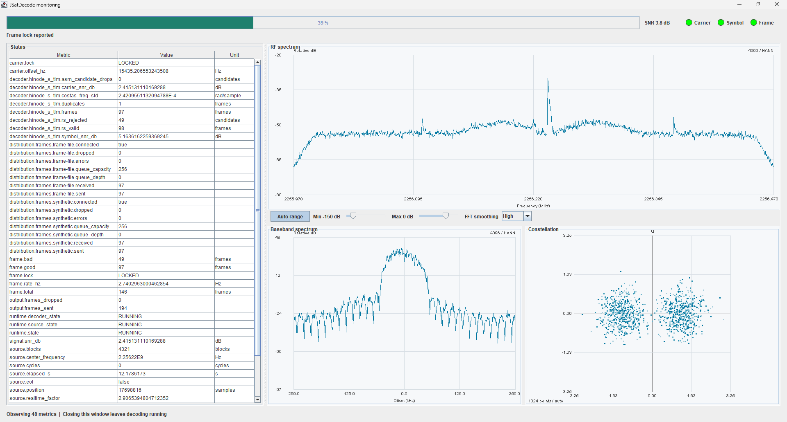
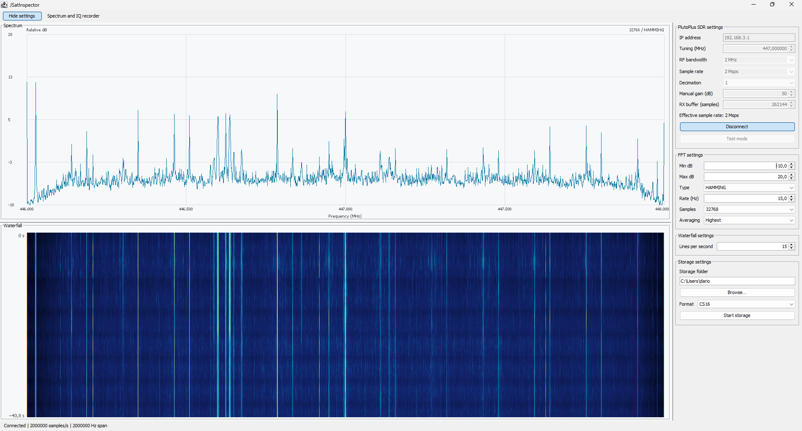

# JSatDecode

JSatDecode is a Java-based framework for the capture, decoding, and data distribution of satellite signals. Designed for flexibility and extensibility, it provides a complete pipeline from signal acquisition through processing to output, supporting both real-time and file-based workflows. The framework features a modular architecture that cleanly separates signal sources, decoders, and distribution outputs, enabling seamless integration of new components. Built on Java SE with no native dependencies, JSatDecode delivers cross-platform compatibility while maintaining high performance through efficient buffer management and non-blocking I/O. It supports standard formats including WAV, CF32, and CS16 for file-based processing, and provides real-time acquisition from supported hardware. The distribution system implements a ZMQ-based protocol for interoperability with other decoding and processing tools.

## Capabilities

JSatDecode provides deterministic file acquisition, live hardware source support, decoder management, ZMQ-based distribution, and optional spectrum and constellation monitoring. JSatInspector offers a standalone spectrum analyzer with waterfall display and IQ recording for PlutoPlus devices, supporting both CF32 and CS16 formats.

## Screenshots

### JSatDecode


### JSatInspector


## Build

See [Distribution and Output](core/docs/runtime.md) for complete build and configuration instructions.

```bash
# Build the project
mvn verify

# Build only core module
mvn -pl core verify
```

The four Java artifacts are explicit Java Platform Module System (JPMS) modules.
See [Java modules](core/docs/java-modules.md) for their names, exported APIs,
service-provider registration and module-path commands.

## Examples

Build and extract the [stand-alone distribution](distribution/README.md), which
includes the mission decoders and runtime dependencies. Run these examples from
the extracted directory on Windows; on Linux/macOS, use `./bin/jsatdecoder.sh`
and `./bin/jsatinspector.sh` instead of the `.bat` launchers.

### Launch JSatDecode CLI
```text
# Show help
bin/jsatdecoder.bat --help

# List available sources
bin/jsatdecoder.bat --list-sources

# List available decoders
bin/jsatdecoder.bat --list-decoders

# Run a decoder with configuration file
bin/jsatdecoder.bat --config myconfig.properties

# Run with file source and headless mode
bin/jsatdecoder.bat --config examples/decoder_hinode/hinode-wav.properties --set source.file=C:/recordings/Hinode_90secs.wav --headless
```

### Launch JSatInspector
```text
# Start the spectrum analyzer and recorder
bin/jsatinspector.bat

# Show help
bin/jsatinspector.bat --help
```

## Documentation

- [Core Documentation](core/README.md) - Source, runtime, distribution, and monitoring configuration
- [Specification](core/specs/JSatDecode_Specification.md) - Current framework behavior and contracts
- [Architecture](core/docs/architecture.md) - Design decisions and implementation details
- [Implementation Guide](core/docs/implementation-guide.md) - Module structure, build and development guidance
- [Java modules](core/docs/java-modules.md) - JPMS dependencies, services and module-path usage
- [Decoder Implementation Guide](core/docs/decoder-implementation-specification.md) - Specification for decoder implementation
- [ZMQ distribution interface](core/docs/zmq-distribution-interface.md) - Specification of ZMQ-based distribution protocol

## Mission Decoders

Available example decoders for satellite missions:

- [Elektro-L GGAK](decoder_elektrol_ggak/README.md)
- [Hinode](decoder_hinode/README.md)

---

## License

This project is licensed under the **GNU General Public License version 2 with the Classpath Exception**.

See the [LICENSE](LICENSE) file for the full license text.

The Classpath Exception allows linking this library with independent modules to produce an executable, regardless of the license terms of those independent modules.
